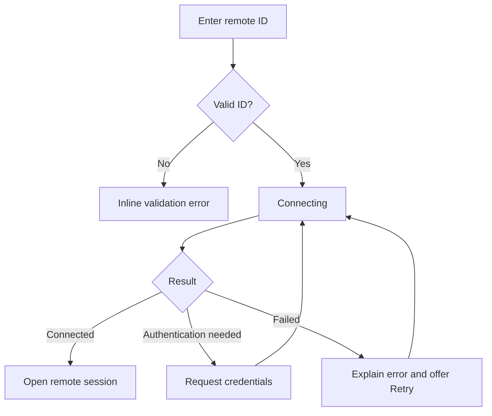
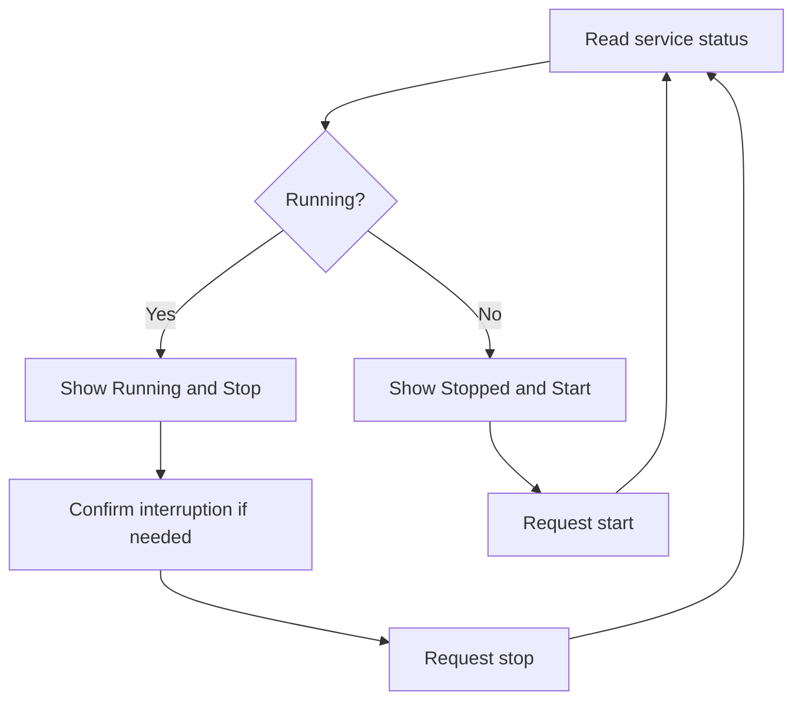

# Webiix Connect — UI/UX Redesign Specification

**Version:** 2.0 proposal  
**Date:** 2026-11-04  
**Scope:** Home, Devices, Settings, navigation, visual identity and interaction states.

## 1. Objectives

Redesign the existing Webiix Connect Windows desktop application to improve clarity, consistency, accessibility, and remote connection workflows. The two primary tasks are **Connect to a remote desktop** and **Share your desktop**. This is a design specification, not a claim that new functionality is already implemented.

## 2. Brand and logo

Use the user-supplied Lucide `infinity` icon as the primary brand symbol. Pair it with the wordmark **Webiix Connect**. Render it at 24–32 px in navigation/title bars, and at larger sizes on splash and About screens. Maintain its aspect ratio, stroke, and accessible label.

```svg
<svg xmlns="http://www.w3.org/2000/svg" width="24" height="24" viewBox="0 0 24 24" fill="none" stroke="currentColor" stroke-width="1.5" stroke-linecap="round" stroke-linejoin="round" class="lucide lucide-infinity"><path d="M12 12c-2-2.67-4-4-6-4a4 4 0 1 0 0 8c2 0 4-1.33 6-4Zm0 0c2 2.67 4 4 6 4a4 4 0 0 0 0-8c-2 0-4 1.33-6 4Z"/></svg>
```

## 3. Visual design system

| Token | Dark mode | Light mode | Usage |
|---|---|---|---|
| Background | `#080F20` | `#F6F8FC` | App window |
| Sidebar | `#0D1930` | `#FFFFFF` | Navigation |
| Surface | `#14233D` | `#FFFFFF` | Cards |
| Raised surface | `#1B2C49` | `#EDF2F9` | Inputs |
| Primary text | `#F7FAFF` | `#15233B` | Headings/content |
| Secondary text | `#B6C5DC` | `#52637B` | Descriptions |
| Border | `#31425D` | `#DCE4EF` | Dividers |
| Brand blue | `#087CFF` | `#086BE8` | Primary action |
| Success | `#34C77B` | `#188B54` | Ready/online |
| Warning | `#F6B64C` | `#A86B09` | Attention |
| Error | `#F16A77` | `#C83245` | Failure |

**Typography:** Segoe UI or Inter; 14 px base, 12–13 px helper text, 18–20 px section headings, 24 px page headings. Use tabular digits for IDs.  
**Spacing:** 4 px system; 8/12/16/24/32 px increments.  
**Corners:** 10 px controls, 14 px cards.  
**Icons:** Lucide, usually 18–24 px.  
**Transitions:** 120–200 ms; respect reduced-motion preferences.

## 4. Global layout

Replace the inconsistent Home top navigation and Settings sidebar with one shared application shell:

- Title bar: infinity brand mark, Webiix Connect wordmark, native Windows controls.
- Left sidebar (176–200 px): **Home**, **Devices**, **Settings**, **About**.
- Main content: fluid width, 20–24 px padding.
- Footer: actual service and connectivity status; never display an unverified encryption claim.
- Active navigation: blue background, readable text, icon and keyboard focus.
- Account/profile section: only if account identity is genuinely available.

## 5. Home screen

### 5.1 Page heading

Title: **Remote access**. Subtitle: **Connect to another device or share this desktop**. Avoid hard-coded personalized greetings.

### 5.2 Control Remote Desktop card

**UI:** large remote ID input, prominent blue **Connect** button, optional mode menu if supported, inline validation and error messages.

**Behavior:**

1. Accept remote IDs in the supported protocol format, optionally formatting spaces for readability.
2. Validate input before enabling Connect.
3. Support Enter to connect.
4. Show `Connecting…` with a spinner and prevent duplicate requests.
5. On authentication challenge, request credentials securely.
6. On failure, explain the reason and provide Retry.
7. Do not persist remote passwords by default.

### 5.3 Your Desktop card

Show **Your ID**, copy ID, **one-time password**, password show/hide, copy password, rotate password (only if supported), and actual **Ready / Not ready** status. Clearly separate service-running status from internet/relay connectivity. Password rotation must invalidate prior credentials when supported. Do not log credentials.

### 5.4 Recent & Saved Devices

- Filters: **Favorites**, **Recent**, **All**.
- Search: device name and remote ID.
- Layout: responsive grid/list toggle.
- Device card: device name, ID, operating system icon if known, status label, favorite action, overflow menu.
- Actions: Connect, Rename, Favorite, Remove (confirm destructive changes).
- States: Online, Offline, Unknown, Connecting. Do not infer online presence from saved-device membership.
- Empty state: `No saved devices yet` with next-step guidance.
- Search empty state: `No devices match your search` and clear-filter action.

### 5.5 UAC installation warning

**Before:** large pink panel dominates the left side and says the client may fail during UAC prompts.  
**After:** compact contextual warning: **Install Webiix Connect to control elevated windows** with **Install service** and **Learn why**. Show only when needed. Confirm privilege escalation, track progress, and verify installation before showing success.

## 6. Settings screen

Keep categories **General**, **Security**, **Network**, **Display**, **Account**, **Printer**, **About**. Present implemented sections; label unimplemented functionality as planned rather than offering dead controls.

### General settings

| Setting | New component | Required behavior |
|---|---|---|
| Service | Status badge + Start/Stop | Read actual service status; confirm if stopping interrupts sessions |
| Theme | Light / Dark / Follow system | Apply immediately and persist |
| Language | Dropdown | Supported locales only; indicate restart requirement |
| Hardware codec | Toggle with description | Explain acceleration; handle unsupported GPU |
| Audio input device | Device dropdown | Detect available devices and disconnections |
| Recording | Toggle with privacy details | Display recording status, consent and save location |

### Additional settings information architecture

**Security:** unattended access, authentication, trusted devices, session approval and audit options, where implemented.  
**Network:** relay/direct connection status, proxy/server settings and diagnostics, where implemented.  
**Display:** scaling, quality, frame rate and multiple monitors, where implemented.  
**Account:** authenticated identity, sign-in and synchronization, where implemented.  
**Printer:** remote printing setup, where implemented.  
**About:** version, build, updates, licenses and support.

## 7. Component inventory

| Component | States |
|---|---|
| `AppShell` | normal, narrow |
| `SidebarNavItem` | idle, hover, active, focus, disabled |
| `PrimaryButton` | default, hover, loading, disabled |
| `RemoteIdField` | empty, valid, invalid, focused |
| `DesktopIdentityCard` | ready, unavailable, loading |
| `DeviceCard` | online, offline, unknown, selected |
| `DeviceFilter` | favorites, recent, all |
| `StatusIndicator` | ready, warning, error, unknown |
| `SettingsRow` | standard, disabled, error |
| `Toggle` | on, off, pending, disabled |
| `InlineAlert` | info, warning, error |
| `ConfirmDialog` | destructive, privilege escalation |

## 8. Connection workflow



## 9. Service workflow



## 10. Accessibility, localization and scaling

- Keyboard navigation with visible focus and logical tab order.
- Accessible labels for Copy ID, Copy password, Show password and Refresh.
- WCAG AA contrast targets; do not use color alone for status.
- Comfortable click targets (target approximately 44 × 44 px).
- Test Windows DPI at 100%, 125%, 150% and 200%.
- Support Persian RTL layouts while preserving left-to-right ID and password display.
- Respect reduced-motion and system high-contrast preferences.
- Never bake translatable text into images.

## 11. Responsive behavior

| Window width | Proposed behavior |
|---|---|
| 1200+ px | Connection + Your Desktop side by side; 3–4 device columns |
| 900–1199 px | Two primary cards if space permits; 2–3 device columns |
| 800–899 px | Stack primary cards; 2 device columns; collapsible sidebar |
| Narrower if supported | Single column; compact navigation; no clipped actions |

Breakpoints must be tested against the actual desktop framework and minimum window dimensions.

## 12. Before vs. after

| Original UI | Redesign | Benefit |
|---|---|---|
| Home tabs and Settings sidebar differ | Shared sidebar | Predictable navigation |
| Remote ID field isolated | Dedicated connection card | Strong primary action |
| ID/password in narrow column | Your Desktop card | Better credential visibility |
| Large pink UAC panel | Contextual install warning | Less distraction |
| Dense multicolor device tiles | Consistent cards, filters and search | Easier discovery |
| Tiny green/orange dots | Text + status color | Better accessibility |
| Settings use large stacked panels | Compact reusable settings rows | Reduced scrolling |
| Service button lacks clear status | Explicit Running/Stopped state | Clear operational feedback |
| Inconsistent spacing | Shared design tokens | Easier maintenance |
| Legacy branding | Infinity icon + consistent wordmark | Cohesive identity |

## 13. Implementation roadmap

### Phase 1 — Foundation
- [ ] Implement tokenized light/dark themes.
- [ ] Add reusable infinity SVG brand component.
- [ ] Build shared app shell, sidebar and footer.
- [ ] Set up accessibility and localization conventions.

### Phase 2 — Home
- [ ] Rebuild remote ID form and validation.
- [ ] Rebuild Your Desktop card and credential actions.
- [ ] Implement device search, filters, cards and empty states.
- [ ] Replace UAC warning with contextual alert.
- [ ] Connect all statuses to real backend data.

### Phase 3 — Settings
- [ ] Build reusable settings rows and controls.
- [ ] Wire service Start/Stop and pending/error states.
- [ ] Wire theme, language, codec, audio and recording controls.
- [ ] Review remaining categories for implemented capabilities.

### Phase 4 — QA
- [ ] Test connection success, failure, timeout and authentication.
- [ ] Test service stopping, installation and UAC elevation.
- [ ] Test keyboard and screen-reader interactions.
- [ ] Test scaling, resizing, themes and Persian RTL.
- [ ] Verify passwords are excluded from logs and telemetry.
- [ ] Verify status and security labels against actual runtime behavior.

## 14. Acceptance criteria

1. At the default window size, Connect and Your Desktop ID are visible without scrolling.
2. Connection actions have clear loading, error and retry states.
3. Service and device status are backed by actual data or labeled Unknown.
4. All controls are keyboard accessible and visibly focused.
5. Settings changes persist or show actionable errors.
6. One-time passwords are not logged or stored by default.
7. Installation warnings appear only when relevant.
8. Home and Settings share navigation and component styling.
9. Infinity logo remains sharp at common DPI scales.
10. Dark/light modes and supported window sizes pass usability review.

## 15. Non-goals and technical cautions

This document does not specify changes to remote-control transport, codec algorithms, NAT traversal, relay infrastructure, or authentication protocol. Encryption indicators, online presence, recording, and unattended-access features must not be presented as available unless supported by the actual implementation. Preserve existing backend behavior while replacing the presentation layer, and introduce functionality only through separately reviewed feature work.
